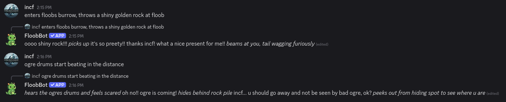
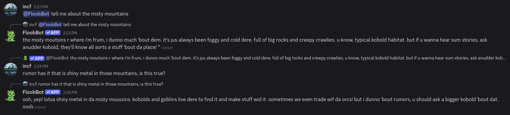
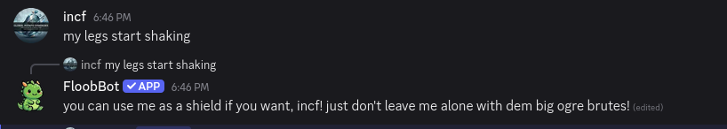

human generated note:

This is a discord bot I made for fun to emulate an ancient and quirky bot named "kobo" in the KoboldAI server. Several events catalyzed this: (1) huggingface stopped offering free compute and the original kobo was lost (2) when KoboldAI crossed 10k users all of the existing LLM bots were purged by discord because they lacked verification. To my knowledge, at the time of writing, I am the first and only person on the server to have filed all of the paperwork for discord verification. The bot has a large number of commands and admin features that help to make its presence more amusing.

machine generated below:

# increbot

A Discord bot that plays **floob**, a small, very old kobold who lives in a
burrow, likes shiny things and is scared of ogres. Replies come from
[LLaMA2-13B-Tiefighter](https://huggingface.co/TheBloke/LLaMA2-13B-Tiefighter-GGUF),
run fully in-process in Rust: GGUF loading, the forward pass and sampling are
written here on top of [Burn](https://burn.dev), with an optional Vulkan GPU
backend. No llama.cpp, no Python, no inference server.







## What it does

- Chats in allowlisted channels and DMs, with recent channel history as context.
- `/ask` for a one-off question, `/retry` for another take, `/undo-retry` and
  `/delete-reply` to take it back.
- Novelty commands: `/roast`, `/fortune`, `/judge`, `/vibe-check`,
  `/hotdog-rater`, `/kobold-name`, `/hoard-value`, `/lick-test` and more.
  Results tied to a user's ID are fixed and never change.
- `/opt-out` and `/opt-in`: the bot ignores your messages entirely
  ([PRIVACY.md](PRIVACY.md)).

The persona (prompt, notes, word biases, stop strings, sampler settings) is one
file, [prompts/c55.rsn](prompts/c55.rsn), named by
[config.rsn](config.rsn). Admins can reload it live.

## Running it

Needs Rust, the model (~7.9 GB, downloaded from Hugging Face on first run) and
a Discord bot token. `glslc` is optional; without it the bot runs CPU-only.

```sh
cp .env.example .env            # put DISCORD_TOKEN=... in it
set -a; . ./.env; set +a
cargo run --release -- serve --config config.rsn
```

Try the persona without Discord in a terminal chat room:

```sh
cargo run --release -p chatsim-tui -- --mock   # scripted replies, no model
cargo run --release -p chatsim-tui             # the real model
```

To run it as a locked-down systemd service in podman, see [deploy.md](deploy.md).

## Docs

- [design.md](design.md): architecture, config, prompt building, Discord behaviour
- [persona-plan.md](persona-plan.md): persona files
- [gpu-plan.md](gpu-plan.md): the Vulkan backend
- [bench/persona/README.md](bench/persona/README.md): how persona candidates are benchmarked
- [PRIVACY.md](PRIVACY.md), [TERMS.md](TERMS.md)

## License

[MIT](LICENSE). This covers the code only. The model weights and tokenizer
download at run time and come under their own licenses: LLaMA2-13B-Tiefighter
under the [Llama 2 Community License](https://ai.meta.com/llama/license/).
